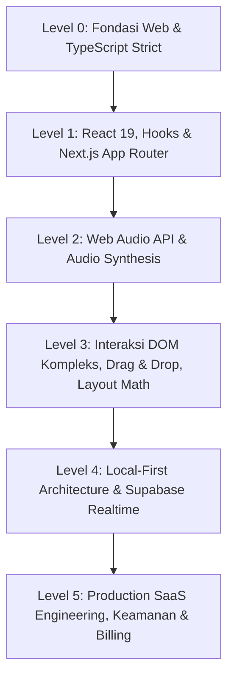

# Master Learning Roadmap & Bedah Kode BiarFokus (A–Z)

Panduan ini disusun khusus agar kamu bisa memahami setiap jengkal kode di proyek **BiarFokus** dari akar sampai pucuk (**A–Z**), mengerti alasan arsitektur di balik setiap baris kodenya, dan memiliki keahlian teknis untuk membangun aplikasi sekelas ini dari nol secara mandiri tanpa bantuan AI sekalipun.

---

## 🗺️ Roadmap Belajar Terstruktur (Level 0 ➔ Level 5)



---

## 🧭 LEVEL 0: Fondasi Web & TypeScript Strict Mode

Sebelum menyelami kode aplikasi, kuasai konsep fundamental ini:

### 1. TypeScript Strict Type Contracts
- **Buka & Pelajari**: [`src/types/domain.ts`](file:///c:/Users/USER/Downloads/saas/src/types/domain.ts)
- **Mengapa File Ini Penting**: Ini adalah *Single Source of Truth* (SSOT) untuk seluruh domain aplikasi. Dari `CalendarEvent`, `KanbanBoard`, `Task`, hingga `UserSubscription`.
- **Konsep Kunci yang Harus Kamu Pelajari**:
  - `Discriminated Unions`: Lihat tipe `TimerMode = "pomodoro" | "short" | "long"`. Tipe ini memastikan kamu tidak bisa salah ketik status.
  - `Optional vs Nullable`: Kapan memakai `string | null` (biasanya dari database PostgreSQL) vs `string?` (properti opsional di TypeScript).
  - `Omit` & `Pick`: Lihat `EventDraft = Omit<CalendarEvent, "id">` di [`calendar-service.ts`](file:///c:/Users/USER/Downloads/saas/src/features/calendar/calendar-service.ts#L21). Digunakan saat membuat data baru yang ID-nya belum digenerate.
- **Rekomendasi Materi Belajar**:
  - Buku: *"Programming TypeScript"* oleh Boris Cherny.
  - Dokumentasi resmi TypeScript: *Utility Types (`Omit`, `Pick`, `Record`, `Partial`)*.

---

## 🧭 LEVEL 1: Next.js App Router & React State Management

### 1. Timestamp-Based Drift-Free Timer
- **Buka & Pelajari**: [`src/features/timer/timer-utils.ts`](file:///c:/Users/USER/Downloads/saas/src/features/timer/timer-utils.ts)
- **Fungsi Kunci**: `getTimerEndTime()` dan `getRemainingSeconds()`
- **Kenapa Dibuat Begini? (Bedah Masalah Nyata)**:
  Banyak programmer pemula membuat timer seperti ini:
  ```ts
  // ❌ JANGAN LAKUKAN INI DI APLIKASI PRODUKSI:
  setInterval(() => { setSeconds(s => s - 1); }, 1000);
  ```
  Masalahnya: Begitu user meminimalkan tab browser atau pindah ke tab lain, browser (Chrome, Firefox, Safari) akan melakukan **Background Tab Throttling** untuk menghemat baterai. Interval 1 detik bisa melambat jadi 2–5 detik sekali! Hasilnya waktu pomodoro 25 menit bisa molor jadi 40 menit.
  
  **Solusi di BiarFokus**:
  Saat tombol Start ditekan, kita catat timestamp target di masa depan:
  ```ts
  timerEndAt = Date.now() + durationSeconds * 1000;
  ```
  Lalu setiap tick, sisa detik dihitung dari:
  ```ts
  remaining = Math.max(0, Math.round((timerEndAt - Date.now()) / 1000));
  ```
  Dengan cara ini, meskipun tab tertidur selama 10 menit, saat dibuka kembali perhitungannya tetap 100% tepat!
- **Rekomendasi Materi Belajar**:
  - Konsep: *JavaScript Event Loop, Task Queue, dan Browser Tab Throttling*.
  - Artikel MDN: *Reasons for delays longer than specified in setTimeout*.

### 2. Provider Global & State Centralization
- **Buka & Pelajari**: [`src/app/providers/app-provider.tsx`](file:///c:/Users/USER/Downloads/saas/src/app/providers/app-provider.tsx)
- **Kenapa Dibuat Begini?**:
  `AppProvider` membungkus timer, autentikasi Supabase, audio settings, daftar task, dan modal state dalam satu context yang dapat diakses oleh komponen manapun lewat custom hook `useAppContext()`.
- **Rekomendasi Materi Belajar**:
  - Pola React Context + Custom Hook Provider.
  - Performa re-rendering React: Kapan membagi context besar menjadi beberapa slice context terisolasi.

---

## 🧭 LEVEL 2: Web Audio API (Sintesis Suara Tanpa File MP3)

BiarFokus memiliki sound engine canggih yang **tidak mendownload file MP3 audio sama sekali**. Semua suara (lonceng alarm, suara ombak, hujan, derau coklat, detik jam, dan denting kalender) dibuat dari manipulasi gelombang matematika secara langsung di browser.

### 1. Alarm Sound & Notifikasi Sintetis
- **Buka & Pelajari**: [`src/features/audio/alarm-sound.ts`](file:///c:/Users/USER/Downloads/saas/src/features/audio/alarm-sound.ts)
- **Fungsi Kunci**: `playAlarmSound()` dan `playCalendarReminderChime()`
- **Kenapa Dibuat Begini?**:
  1. *Hemat kuota & bandwidth*: Ukuran file MP3 2–5MB bisa memperlambat loading PWA. Kode sintetis ini hanya berukuran beberapa kilobyte.
  2. *Zero-Latency*: Suara berbunyi seketika tanpa jeda buffering jaringan.
  3. *100% Offline*: Bekerja di kondisi apapun tanpa internet.
- **Bedah Kode `playCalendarReminderChime()`**:
  ```ts
  const osc = context.createOscillator();
  const gainNode = context.createGain();
  osc.type = "sine";
  osc.frequency.setValueAtTime(659.25, time); // Nada E5
  gainNode.gain.setValueAtTime(0.001, time);
  gainNode.gain.linearRampToValueAtTime(0.22, time + 0.025); // Attack
  gainNode.gain.exponentialRampToValueAtTime(0.0001, time + dur); // Decay
  ```
  Di sini kita membuat nada lonceng harmonis dua nada (E5 659Hz diikuti B5 987Hz) dengan kurva ADSR (*Attack, Decay, Sustain, Release*) eksponensial sehingga suaranya terdengar lembut seperti notifikasi iOS atau Google Calendar.
- **Rekomendasi Materi Belajar**:
  - Konsep: *Web Audio API, AudioContext, OscillatorNode, GainNode, AudioParam Automation (`exponentialRampToValueAtTime`)*.
  - Konsep Musik Digital: *Envelope ADSR, Harmonics, dan Frekuensi Not Musik standar (A4 = 440Hz)*.

### 2. Ambient Noise Generator (Rain, Waves, Brown Noise)
- **Buka & Pelajari**: [`src/features/audio/ambient-sound.ts`](file:///c:/Users/USER/Downloads/saas/src/features/audio/ambient-sound.ts)
- **Fungsi Kunci**: `generatePinkNoiseBuffer()`, `generateBrownNoiseBuffer()`, `createWavesAudio()`
- **Kenapa Dibuat Begini?**:
  Brownian/Brown noise dibuat dengan mengintegrasikan *white noise* acak (`Math.random() * 2 - 1`) dan dilewatkan ke `BiquadFilterNode` berjenis `lowpass`. Suara ombak pantai disimulasikan dengan memodulasi frekuensi cutoff filter secara periodik menggunakan sinus berosilasi perlahan.
- **Rekomendasi Materi Belajar**:
  - Konsep: *Digital Signal Processing (DSP) dasar, White/Pink/Brown Noise, BiquadFilter (Low-pass, High-pass)*.

---

## 🧭 LEVEL 3: Interaksi DOM Kompleks, Drag & Drop & Layout Math

### 1. Pointer Events Drag and Drop (Kanban Engine)
- **Buka & Pelajari**: [`src/app/components/kanban/kanban-view.tsx`](file:///c:/Users/USER/Downloads/saas/src/app/components/kanban/kanban-view.tsx)
- **Fungsi Kunci**: `handleCardPointerDown()`, `handlePointerMove()`, `handlePointerUp()`
- **Kenapa Dibuat Manual dengan Pointer Events (Bukan Library External)?**:
  Library seperti `react-beautiful-dnd` atau `dnd-kit` seringkali bermasalah dengan touch scrolling pada mobile, berat ukuran bundlenya, dan sulit dikustomisasi perilakunya. Menggunakan **Pointer Events API** native (`pointerdown`, `pointermove`, `pointerup` + `setPointerCapture`) memberikan performa 60fps tanpa overhead dan mendukung mouse desktop, touch screen HP, maupun stylus tablet secara mulus.
- **Rekomendasi Materi Belajar**:
  - MDN: *Pointer Events API (`setPointerCapture`, `releasePointerCapture`)*.
  - DOM Geometry: *`Element.getBoundingClientRect()`, `clientX`, `clientY`, Scroll Offsets*.

### 2. Overlap Scheduling Algorithm (Google Calendar Layout)
- **Buka & Pelajari**: [`src/features/calendar/calendar-service.ts`](file:///c:/Users/USER/Downloads/saas/src/features/calendar/calendar-service.ts#L382)
- **Fungsi Kunci**: `layoutDayEvents()`
- **Kenapa Dibuat Begini? (Masalah Algoritma Nyata)**:
  Jika ada 3 event:
  - Event A: 09:00 - 11:00
  - Event B: 09:30 - 10:15
  - Event C: 10:00 - 12:00
  Bagaimana cara menaruhnya di layar agar tidak bertumpukan teksnya?
  Fungsi `layoutDayEvents()` menggunakan algoritma **Greedy Interval Clustering**:
  1. Mengurutkan event berdasarkan jam mulai.
  2. Mengelompokkan event-event yang saling tumpang tindih ke dalam satu *cluster*.
  3. Membagi cluster ke dalam kolom-kolom independen (`column` dan `columns`).
  4. Menghitung posisi CSS: `left = (column / columns) * 100%`, `width = (1 / columns) * 100%`.
- **Rekomendasi Materi Belajar**:
  - Algoritma: *Greedy Interval Scheduling, Interval Graph Coloring*.

---

## 🧭 LEVEL 4: Local-First Architecture & Realtime Supabase

### 1. Multi-Tab Reactive Local Store
- **Buka & Pelajari**: [`src/lib/storage/local-store.ts`](file:///c:/Users/USER/Downloads/saas/src/lib/storage/local-store.ts)
- **Fungsi Kunci**: `useLocalStoreValue()`
- **Kenapa Dibuat Begini?**:
  Jika user membuka BiarFokus di dua tab browser berdampingan: tab 1 mengubah task, bagaimana tab 2 tahu tanpa reload?
  `useLocalStoreValue` mendengarkan event `BroadcastChannel` dan `window.addEventListener("storage")`. Setiap mutasi di satu tab langsung di-broadcast ke seluruh tab lain secara instan!
- **Rekomendasi Materi Belajar**:
  - Browser API: *`BroadcastChannel API` vs `SharedWorker` vs `localStorage StorageEvent`*.

### 2. Bidirectional Cloud Sync & Tombstone Deletion
- **Buka & Pelajari**: [`src/features/calendar/use-calendar-events.ts`](file:///c:/Users/USER/Downloads/saas/src/features/calendar/use-calendar-events.ts)
- **Fungsi Kunci**: `performCloudSync()`, `markEventDeleted()`
- **Kenapa Dibuat Begini? (Masalah Sinkronisasi Nyata)**:
  Jika user menghapus sebuah event saat offline, lalu kembali online dan melakukan fetch dari cloud, event yang dihapus di lokal bisa ter-unduh kembali jika tidak dicatat!
  Itulah gunanya **Tombstone**: kita menyimpan ID yang baru saja dihapus di `deleted_ids`. Saat menggabungkan (*merge*) data dari Supabase, ID yang ada di tombstone akan diabaikan dan dihapus dari cloud.
- **Rekomendasi Materi Belajar**:
  - Konsep Arsitektur: *Local-First Software (oleh Ink & Switch), Conflict-Free Replicated Data Types (CRDTs), Soft Delete & Tombstones*.

### 3. Realtime Supabase Postgres Changes
- **Buka & Pelajari**: [`src/features/kanban/use-kanban-board.ts`](file:///c:/Users/USER/Downloads/saas/src/features/kanban/use-kanban-board.ts)
- **Kode Kunci**: `supabase.channel(...).on('postgres_changes', ...)`
- **Kenapa Dibuat Begini?**:
  Memungkinkan fitur kolaborasi kanban layaknya Trello atau Figma: saat rekan tim memindahkan kartu, board di komputermu bergerak sendiri secara otomatis tanpa perlu merefresh halaman.
- **Rekomendasi Materi Belajar**:
  - Supabase Realtime: *Postgres CDC (Change Data Capture), Row Level Security (RLS) pada Realtime Channels*.

---

## 🧭 LEVEL 5: Production Engineering, Keamanan & Billing

### 1. Request Guard & Rate Limiting
- **Buka & Pelajari**: [`src/lib/api/request-guard.ts`](file:///c:/Users/USER/Downloads/saas/src/lib/api/request-guard.ts)
- **Fungsi Kunci**: `createRateLimiter()`, `getClientKey()`, `resolveCorrelationId()`
- **Kenapa Dibuat Begini?**:
  Mencegah bot membombardir API endpoint dengan sliding-window in-memory rate limiter. Juga menyematkan `x-correlation-id` pada setiap response API untuk mempermudah pelacakan log error jika terjadi kegagalan transaksi di sistem produksi.
- **Rekomendasi Materi Belajar**:
  - Konsep Keamanan: *Sliding Window Counter Rate Limiting, IP Spoofing Prevention (`x-forwarded-for`), Observability & Distributed Tracing*.

### 2. SaaS Billing & Entitlement Enforcer
- **Buka & Pelajari**: [`src/features/billing/billing-service.ts`](file:///c:/Users/USER/Downloads/saas/src/features/billing/billing-service.ts)
- **Fungsi Kunci**: `assertTaskLimitAllowed()`, `isProSubscription()`
- **Kenapa Dibuat Begini?**:
  Memisahkan antara data tier gratis dan berbayar. Pengguna gratis dibatasi jumlah task aktif, sedangkan pengguna Pro mendapatkan akses tanpa batas. Validasi dilakukan ganda: di sisi client untuk UX responsif, dan di API backend untuk integritas keamanan.
- **Rekomendasi Materi Belajar**:
  - SaaS Architecture: *Feature Gating, Entitlement Verification, Webhook Idempotency (Midtrans/Stripe)*.

---

## 🧪 Testing & Verifikasi Kode Mandiri

Semua unit test di proyek ini menggunakan test runner native bawaan Node.js:
- **Jalankan Test**: `npm test`
- **File Test Utama untuk Dipelajari**:
  1. [`calendar-service.test.ts`](file:///c:/Users/USER/Downloads/saas/src/features/calendar/calendar-service.test.ts): Memvalidasi kalkulasi tanggal, recurrence harian/mingguan, layout overlap kolom, format iCalendar (.ics), dan threshold notifikasi jadwal.
  2. [`request-guard.test.ts`](file:///c:/Users/USER/Downloads/saas/src/lib/api/request-guard.test.ts): Menguji rate limiter dan header correlation.
  3. [`timer-utils.test.ts`](file:///c:/Users/USER/Downloads/saas/src/features/timer/timer-utils.test.ts): Menguji transisi siklus Pomodoro (sesi 1..3 istirahat pendek, sesi 4 istirahat panjang).

---

## 🚀 Langkah Praktek Bertahap Untukmu

Untuk menguji pemahamanmu secara mandiri, coba lakukan eksperimen bertahap ini:
1. **Latihan 1**: Buka [`alarm-sound.ts`](file:///c:/Users/USER/Downloads/saas/src/features/audio/alarm-sound.ts), coba tambahkan melodi alarm baru ke-5 (misalnya nada *Cyberpunk Arpeggio* dengan frekuensi 523Hz -> 659Hz -> 783Hz -> 1046Hz).
2. **Latihan 2**: Buka [`calendar-service.ts`](file:///c:/Users/USER/Downloads/saas/src/features/calendar/calendar-service.ts), amati bagaimana `toISODate()` bekerja menghindari bug UTC offset. Coba buat fungsi helper untuk mendeteksi apakah dua range waktu bertabrakan (`isTimeRangeOverlapping`).
3. **Latihan 3**: Buka [`use-calendar-reminders.ts`](file:///c:/Users/USER/Downloads/saas/src/features/calendar/use-calendar-reminders.ts), coba tambahkan opsi pengingat 30 menit sebelum jadwal dimulai selain 10 menit.
4. **Latihan 4**: Jalankan `npm test` setiap kali kamu membuat modifikasi untuk memastikan tidak ada logika yang rusak.

Dengan memahami pola-pola arsitektur di atas, kamu bukan hanya bisa membuat ulang BiarFokus dari nol, tapi juga siap membangun aplikasi web modern kelas dunia dengan arsitektur yang solid, cepat, dan profesional!
